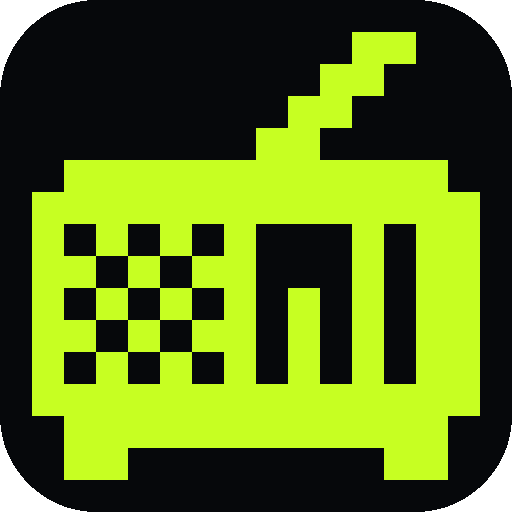

<h1 align="center">Pixel Radio brand kit</h1>

Logos, colors, fonts and images for writing about <a href="https://pixelradio.app/en/">Pixel Radio</a> —
24/7 music radio for Telegram group voice chats.

---

## Logo

| File | Use |
| --- | --- |
| [`logo/pixel-radio-logo.svg`](logo/pixel-radio-logo.svg) | Vector logo: websites, print, any size |
| [`logo/pixel-radio-logo-512.png`](logo/pixel-radio-logo-512.png) | Square avatar for profiles and catalogs |
| [`logo/pixel-radio-logo-maskable-512.png`](logo/pixel-radio-logo-maskable-512.png) | App icon with safe padding (round or squircle masks) |
| [`logo/pixel-radio-avatar.png`](logo/pixel-radio-avatar.png) | Avatar of the Telegram bot |

The logo is pixel art: scale it by whole multiples and keep `image-rendering: pixelated` so the pixels stay sharp.
Don't recolor, stretch, rotate or add effects to it. Leave at least one logo-pixel of empty space around it.

## Colors

| Name | Hex | Use |
| --- | --- | --- |
| Acid | `#C7FF22` | Accent: buttons, highlights, the logo |
| Ink | `#06080B` | Background |
| Panel | `#0F1318` | Cards and surfaces |
| Panel 2 | `#181D24` | Raised surfaces |
| Text | `#F2F4F7` | Main text |
| Muted | `#A0AAB7` | Secondary text |
| On acid | `#10140A` | Text on the acid accent |

The look is dark, with a faint 40 px grid on the background and the acid accent used sparingly.

## Fonts

- **[Pixelify Sans](https://fonts.google.com/specimen/Pixelify+Sans)** — the logo word, short accents and numbers.
- **[Manrope](https://fonts.google.com/specimen/Manrope)** — headings and text in promo materials.
- **[Space Mono](https://fonts.google.com/specimen/Space+Mono)** / **[JetBrains Mono](https://www.jetbrains.com/lp/mono/)** — labels and technical captions.

All four are free under the SIL Open Font License.

## Images

| File | Size |
| --- | --- |
| [`social/pixel-radio-og-en-1200x630.png`](social/pixel-radio-og-en-1200x630.png) | Link preview, English |
| [`social/pixel-radio-og-ru-1200x630.png`](social/pixel-radio-og-ru-1200x630.png) | Link preview, Russian |
| [`wallpapers/pixel-radio-desktop-2560x1440.png`](wallpapers/pixel-radio-desktop-2560x1440.png) | Desktop wallpaper |
| [`wallpapers/pixel-radio-phone-1440x2560.png`](wallpapers/pixel-radio-phone-1440x2560.png) | Phone wallpaper, Telegram channel background |

## Naming

Write **Pixel Radio** — two words, both capitalized. The bot is **@PixelRadiobot**, the channel is **@Pixel_Radio**.

## Usage

You may use these files to write about, review, link to or list Pixel Radio. Don't use them in a way that suggests
your product is made or endorsed by Pixel Radio. The Pixel Radio name and logo remain the property of their owner.

Questions: [info@pixelradio.app](mailto:info@pixelradio.app) · [Website](https://pixelradio.app) ·
[Bot](https://t.me/PixelRadiobot) · [Channel](https://t.me/Pixel_Radio)
